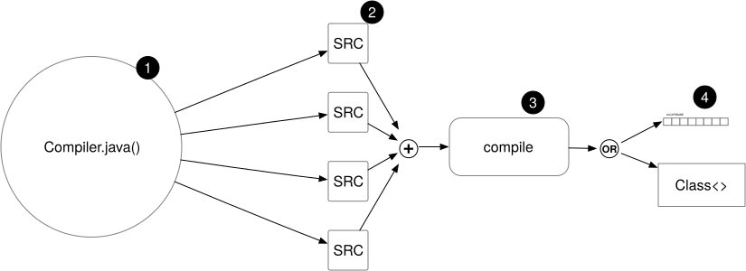
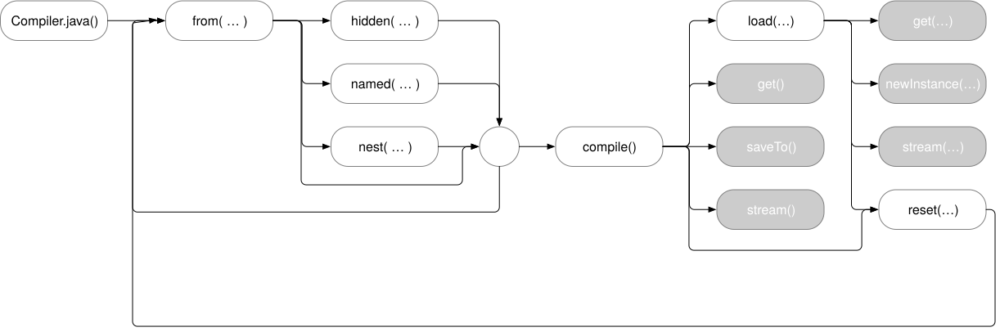
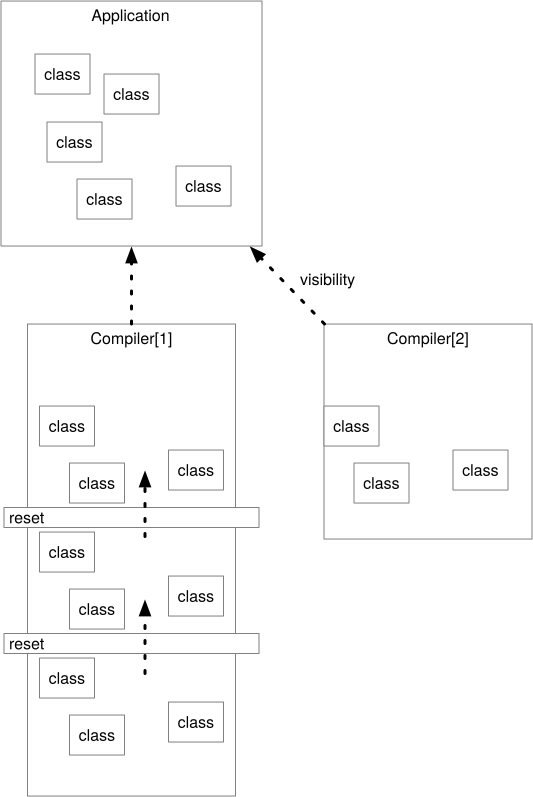

# SourceBuddy

<!--IMPORT
name: "pom"
from: "pom.xml"
-->
<!--SIP
name: "build"
from: "pom.xml"
vars:
  javaRelease: '<release>(\d+)</release>'
-->
<!--SIP
name: "bytecode"
from: "src/main/java/com/javax0/sourcebuddy/ByteCodeGouger.java"
vars:
  jvm: 'JVM_VERSION = (\d+)'
  java: 'JAVA_VERSION = (\d+)'
-->
<!--SIP
name: "loader"
from: "src/main/java/com/javax0/sourcebuddy/ByteClassLoader.java"
vars:
  package: '^package\s(.+);'
-->
<!--SIP
name: "fluent"
from: "src/main/java/com/javax0/sourcebuddy/Fluent.java"
strategy: "concatenate"
separator: "\n"
vars:
  options: '^\s+//\s+((?!snippet\b|end snippet\b).*)$'
-->
<!--SIP
name: "demo"
from: "src/test/java/com/sb/demo/TestDemo.java"
strategy: "first"
vars:
  compileLine: '^\s*(Class<\?> myClassClass\s+=.*)$'
-->

## Introduction

*This documentation is about the version <!--$pom.project.version<>-->2.5.4-SNAPSHOT<!----> of the software.*

SourceBuddy is a Java library you can use to compile and load dynamically generated Java source code in your program.

You can compile Java source code you created dynamically in your Java application.
Your program can create the source code of one or more Java classes, pass the strings to SourceBuddy and use the classes.
An example code is the following:

<!--INCLUDE
from: "src/test/java/com/sb/demo/TestDemo.java"
prefix: "```java"
postfix: "```"
margin: 0
start: 'snippet simple_compile$'
end: 'end snippet'
_content_generated_: 416:md5:a5bed034b25ddc92f7da03aaa5c3efd1
# ⚠️ MANAGED CONTENT: Edits will be lost.
# danger zone: Delete _content_generated_ to override.
-->
```java
String source = """
        package com.sb.demo;
                        
        public class MyClass implements Talker {
            @Override // comment
            public void say() {
                System.out.println("Hello, Buddy!");
          }
        }""";
Class<?> myClassClass = Compiler.compile(source);
Talker myClass = (Talker) myClassClass.getConstructor().newInstance();
myClass.say();
```
<!--/INCLUDE-->

SourceBuddy is a simple Java source compiler facade in front of the JDK-provided `javac` compiler.
You need to follow the steps as depicted here:



1. get a `Compiler` object calling `Compiler.java()`, and from there, all you need is
2. specify the source code either as Java strings or files,
3. call `compile()`,
4. fetch the compiled `.class` files as `byte[]` byte array, save to file, or the load the classes, and
5. use the class and instances (not on the picture, it is already up to you).

There are two apis.

* A simple API with one call for simple cases compiling one class only, and

<!--INCLUDE
from: "src/test/java/com/sb/demo/TestDemo.java"
prefix: "```java"
postfix: "```"
margin: 0
start: 'snipline simpleCompileOneLine$'
end:
  pattern: '.'
  include: true
_content_generated_: 70:md5:163e14c4bbc2795c91ebdb0ee118cd37
# ⚠️ MANAGED CONTENT: Edits will be lost.
# danger zone: Delete _content_generated_ to override.
-->
```java
Compiler.compile(source).getConstructor().newInstance();
```
<!--/INCLUDE-->

* a more versatile fluent API for cases being a bit more complex.

<!--INCLUDE
from: "src/test/java/com/sb/demo/TestDemo.java"
prefix: "```java"
postfix: "```"
margin: 0
start: 'snipline fluent_api_intro$'
end:
  pattern: '.'
  include: true
_content_generated_: 86:md5:8d95d01f125ebe03537005a485432e7c
# ⚠️ MANAGED CONTENT: Edits will be lost.
# danger zone: Delete _content_generated_ to override.
-->
```java
Compiler.java().from(source).compile().load().newInstance(Talker.class);
```
<!--/INCLUDE-->

In this document, we will explain the details of how to use the library, including

* Maven coordinates,

* Simple API,

* Fluent API,

* Handling Hidden Classes,

* Creating and Loading Inner Classes, and

* Support.

## Maven Coordinates

The library is available from Maven central.
The Maven central coordinates are:

<!--JINJA2
content: |
  ```xml
  <dependency>
      <groupId>{{ pom.project.groupId }}</groupId>
      <artifactId>{{ pom.project.artifactId }}</artifactId>
      <version>{{ pom.project.version }}</version>
  </dependency>
  ```
_content_generated_: 164:md5:d0fc87975b5239bf2ad7559e311ccdf0
# ⚠️ MANAGED CONTENT: Edits will be lost.
# danger zone: Delete _content_generated_ to override.
-->
```xml
<dependency>
    <groupId>com.javax0.sourcebuddy</groupId>
    <artifactId>SourceBuddy</artifactId>
    <version>2.5.4-SNAPSHOT</version>
</dependency>
```
<!--/JINJA2-->

SourceBuddy requires Java <!--$build.javaRelease<>-->17<!---->.

The library is modularized starting with the release `2.5.2`.
It means that you have to add a `requires` statement to your `module-info.java` file.

Documentation on the different [releases](RELEASES.md).

## Simple API

You can use the simple API in simple projects compiling and loading one class at a time.
To do that, the class `com.javax0.sourcebuddy.Compiler` defines a static method `compile()`.
Here is the line from the example displayed in the introduction using this method:

<!--JINJA2
content: |
  ```java
  {{ demo.compileLine }}
  ```
_content_generated_: 63:md5:0bc7aece4c59b39634e9b7b59d404643
# ⚠️ MANAGED CONTENT: Edits will be lost.
# danger zone: Delete _content_generated_ to override.
-->
```java
Class<?> myClassClass = Compiler.compile(source);
```
<!--/JINJA2-->

The method's parameter is the string source code of the class.

The method's return value is the class compiled and loaded into the JVM.

If there is an error during the compilation, the call will throw a `CompileException` with the error message in the exception message.

There are four overloaded versions of the static `compile()` method.
Using the previous source code, it can be compiled in four different ways:

<!--INCLUDE
from: "src/test/java/com/sb/demo/TestDemo.java"
prefix: "```java"
postfix: "```"
margin: 0
start: 'snippet overloaded_versions$'
end: 'end snippet'
_content_generated_: 271:md5:f04991b2da93003fe4b1077e3aeccf63
# ⚠️ MANAGED CONTENT: Edits will be lost.
# danger zone: Delete _content_generated_ to override.
-->
```java
Class<?> objectClassImplicitName = Compiler.compile(source);
Class<?> objectClass = Compiler.compile(name, source);
Class<Talker> classImplicitName = Compiler.compile(source, Talker.class);
Class<Talker> klass = Compiler.compile(name, source, Talker.class);
```
<!--/INCLUDE-->

1. Providing only the source code as we have already seen before.
2. Providing the name of the class and the source code.
This version should be used, when the library cannot figure out the name of the class from the source code.
The library uses simple pattern matching to find the package and class names in the Java source.
3. The same as the first version, but you can also provide a class for the loaded type.
This can be used when the class in the source code implements and interface or extends a class which is available during the compile time.
The returned class object can be cast to that type and the library will do that casting for you.
4. The same as the second version, but again you can provide a class for the casting.

## Fluent API

The fluent API is available when there are more files to be compiled.



To demonstrate the use of the API, we will use the sample code:

<!--INCLUDE
from: "src/test/java/com/sb/demo/TestDemo.java"
prefix: "```java"
postfix: "```"
margin: 0
start: 'snippet api_doc$'
end: 'end snippet'
_content_generated_: 858:md5:9940fbcd355048fbcfd69d6bb8f9374f
# ⚠️ MANAGED CONTENT: Edits will be lost.
# danger zone: Delete _content_generated_ to override.
-->
```java
String sourceFirstClass = """
        package com.sb.demo;

        public class FirstClass {
            public String a() {
                return "x";
          }
        }""";
final var compiled = Compiler.java()
        .options("-g:none")
        .from("com.sb.demo.FirstClass", sourceFirstClass)
        .from(Paths.get("src/test/resources/src"))
        .compile();
compiled.saveTo(Paths.get("./target/generated_classes"));
compiled.stream().forEach(bc -> System.out.println(Compiler.getBinaryName(bc)));
final var loaded = compiled.load();
Class<?> firstClassClass = loaded.get("com.sb.demo.FirstClass");
Object firstClassInstance = loaded.newInstance("com.sb.demo.FirstClass");
loaded.stream().forEach(klass -> System.out.println(klass.getSimpleName()));
final var compiler = loaded.reset();
final var sameCompiler = compiled.reset();
```
<!--/INCLUDE-->

In the following sections we wil go through the lines of the code explaining their meaning.

### 1. Get the compiler object

To start the compilation, you must have a `Compiler` object.
To get that, you have to call the

<!--INCLUDE
from: "src/test/java/com/sb/demo/TestDemo.java"
prefix: "```java"
postfix: "```"
margin: 0
start:
  pattern: '^\s*final\ var\ compiled\ =\ Compiler\.java\(\)$'
  include: true
end:
  pattern: '.*'
_content_generated_: 50:md5:3631123f38cdfa63d0dc4c313b15756a
# ⚠️ MANAGED CONTENT: Edits will be lost.
# danger zone: Delete _content_generated_ to override.
-->
```java
final var compiled = Compiler.java()
```
<!--/INCLUDE-->

### 2. Compiler Options

You can set compiler options calling the method `options()`.

<!--INCLUDE
from: "src/test/java/com/sb/demo/TestDemo.java"
prefix: "```java"
postfix: "```"
margin: 0
start:
  pattern: '^\s*\.options\("\-g:none"\)$'
  include: true
end:
  pattern: '.*'
_content_generated_: 33:md5:af97e5e9b1e66f250e0db42a2f2ed3a4
# ⚠️ MANAGED CONTENT: Edits will be lost.
# danger zone: Delete _content_generated_ to override.
-->
```java
.options("-g:none")
```
<!--/INCLUDE-->

In the example we are setting the option `-g:none`.

You can use the same options as you would use when calling the `javac` compiler from the command line.
Use the strings as you would use them in the command line including the leading `-` for the option keywords and using separate arguments for the values separated by spaces on the command line.

In addition to the method `options()` there are convenience methods defined in the fluent API to set the most common options in a readable way.
These methods are

<!--JINJA2
content: |
  {{ fluent.options | replace("\n+\n[source,java]\n----\n", "\n\n  ```java\n  ") | replace("\n----\n+\n", "\n  ```\n\n  ") }}
_content_generated_: 1353:md5:84ec52c25e0b839d37c9e9c9043021b8
# ⚠️ MANAGED CONTENT: Edits will be lost.
# danger zone: Delete _content_generated_ to override.
-->
* `release(int)` sets the release version of the Java compiler.
* `source(int)` sets the source version of the Java compiler.
* `target(int)` sets the target version of the Java compiler.
* `encoding(Charset)` sets the encoding of the source files.
* `verbose()` sets the compiler to be verbose.
* `debugInfo(DebugInfo)` sets the debug information level of the compiler.
The possible values are `NONE`, `LINES`, `SOURCE`, `VARS`, and `ALL` as listed in the enumeration.
* `noDebugInfo()` sets the compiler to suppress debug information.
* `nowarn()` sets the compiler to suppress warnings.
* `showDeprecation()` sets the compiler to show deprecation warnings.
* `parameters()` sets the compiler to store formal parameter names of constructors and methods in the generated class files.
* `addExports(Export...)` adds export directives to the module declaration.
To create an `Export` object, use the methods of the class `Export`.
A typical usage is

  ```java
  addExports(Export.from("module").thePackage("package").to("otherModule"))
  ```

  You can make a static import for the method `from` to make the code more readable.
* `addModules(String...)` adds required modules to the module declaration.
* `limitModules(String...)` limits the modules that are visible during compilation.
* `module(String)` sets the module name of the compiled classes.
<!--/JINJA2-->

The line in the example calls the method `options()` directly.
Using the complimentary methods, we could have written the line as

```java
.debugInfo(NONE);
```

or even

```java
.noDebugInfo();
```

Adding options is not mandatory.

### 3. Add sources

The next step is to add the source files to the compiler object.
To do that, you can specify the sources one by one as strings, or you can add directories where the source files are.
The overloaded method `from()` is used for both operations.

To add sources individually, you can call

<!--INCLUDE
from: "src/test/java/com/sb/demo/TestDemo.java"
prefix: "```java"
postfix: "```"
margin: 0
start:
  pattern: '^\s*\.from\("com\.sb\.demo\.FirstClass",\ sourceFirstClass\)$'
  include: true
end:
  pattern: '.*'
_content_generated_: 63:md5:6f412825bdd9f4b2545f99989fd3a76b
# ⚠️ MANAGED CONTENT: Edits will be lost.
# danger zone: Delete _content_generated_ to override.
-->
```java
.from("com.sb.demo.FirstClass", sourceFirstClass)
```
<!--/INCLUDE-->

The first argument is the binary name of the class.
The second is the actual source code.

You can omit the class name.
This information is already in the source code after all.
The class name is required by the JDK compiler.
SourceBuddy has to provide it.
To do that, it either gets it as an argument or tries to figure out even before compiling the code.
Use the one without the name, and specify the name only in special cases when SourceBuddy cannot identify it.

To add multiple sources, you can call this method multiple times.

If the sources are in the file system in a directory, you can also call

<!--INCLUDE
from: "src/test/java/com/sb/demo/TestDemo.java"
prefix: "```java"
postfix: "```"
margin: 0
start:
  pattern: '^\s*\.from\(Paths\.get\("src/test/resources/src"\)\)$'
  include: true
end:
  pattern: '.*'
_content_generated_: 56:md5:1f69d5410899fa95cf2d5049b318d102
# ⚠️ MANAGED CONTENT: Edits will be lost.
# danger zone: Delete _content_generated_ to override.
-->
```java
.from(Paths.get("src/test/resources/src"))
```
<!--/INCLUDE-->

In this call, you specify only one parameter.
A path pointing to the source root.
It is the directory where the directory structure matching the Java package structure starts.
You can have many calls to this method if you have multiple source trees on the disk.
You can also add some sources as strings, individually and others scanned from the file system.

> [!NOTE]
> **Class name calculation**
>
> The class names are calculated from the directory structure and the name of the file.
> The class name of a single class is calculated the same way as before when the path points to a single file.
> You can also provide the class name as string and a path to a single source file.

### 4. Hide the class

You can call the method `hidden()` when you want to load a class hidden.
Hidden and non-hidden classes can be mixed in one SourceBuddy compiler object.
You can either call `hidden()`, `named()`, or `nest()`.
These calls are optional, but only one of them should be called for a source.
Different versions of these methods accept arguments to specify lookup object, and class loading configuration.

Loading hidden classes is a complex topic, and it is detailed later in a separate chapter.

### 5. Compile

After the program loaded the sources, the next thing is to compile:

<!--INCLUDE
from: "src/test/java/com/sb/demo/TestDemo.java"
prefix: "```java"
postfix: "```"
margin: 0
start:
  pattern: '^\s*\.compile\(\);$'
  include: true
end:
  pattern: '.*'
_content_generated_: 25:md5:1259d605c73a665b9ccd11a3562c7892
# ⚠️ MANAGED CONTENT: Edits will be lost.
# danger zone: Delete _content_generated_ to override.
-->
```java
.compile();
```
<!--/INCLUDE-->

The compilation generates the bytes codes for the Java source files.
They are not loaded as Java classes into the memory yet, but are available for loading or direct byte code access.

### 6. Save the byte codes

The next step is saving the byte codes.
It is not a must.
You can ignore this step if you do not need the compiled byte codes in the file system.

<!--INCLUDE
from: "src/test/java/com/sb/demo/TestDemo.java"
prefix: "```java"
postfix: "```"
margin: 0
start:
  pattern: '^\s*compiled\.saveTo\(Paths\.get\("\./target/generated_classes"\)\);$'
  include: true
end:
  pattern: '.*'
_content_generated_: 71:md5:ff8148aec1b69b35b92624fe98f20fcf
# ⚠️ MANAGED CONTENT: Edits will be lost.
# danger zone: Delete _content_generated_ to override.
-->
```java
compiled.saveTo(Paths.get("./target/generated_classes"));
```
<!--/INCLUDE-->

The argument to this method is the path to where the program will save the class files.
If the directory does not exist, the code will create it recursively.
It will create all the subdirectories corresponding to the package structure.
Adding this directory to a standard URL class loader will be able to load these files from the disk.

The return value of this method is `void`, not chainable.
This method is usually the last action you invoke on a compiler.

### 7. Stream through the byte codes

Sometimes you do not want to save the byte code to `.class` files.
You can use the compiler object at this stage to iterate through the compiled codes, calling

<!--INCLUDE
from: "src/test/java/com/sb/demo/TestDemo.java"
prefix: "```java"
postfix: "```"
margin: 0
start:
  pattern: '^\s*compiled\.stream\(\)\.forEach\(bc\ \->\ System\.out\.println\(Compiler\.getBinaryName\(bc\)\)\);$'
  include: true
end:
  pattern: '.*'
_content_generated_: 94:md5:15222590e7b3fb3c6c6504acb0220867
# ⚠️ MANAGED CONTENT: Edits will be lost.
# danger zone: Delete _content_generated_ to override.
-->
```java
compiled.stream().forEach(bc -> System.out.println(Compiler.getBinaryName(bc)));
```
<!--/INCLUDE-->

The return value of the method `stream()` at this point is `Stream<byte[]>`.
It is up to you how you use these byte arrays.

Many times you may also need the binary name of the class.
You can call the static method `Compiler.getBinaryName()` to get the name.
It is a utility method that gauges the name of the class from the binary representation.
You can use this method for any byte code, not only those compiled with the compiler.

> [!NOTE]
> The `getBinaryName()` implementation supports JVM byte code up to <!--$bytecode.jvm<>-->71<!---->, which is Java <!--$bytecode.java<>-->27<!---->.
> Note that these version values are automatically pulled from the source code using mdship.
> They are always up-to-date in this documentation.

### 8. Load the classes
Applications usually want to load the classes after compilation.
The aptly named method `load()` does that.

<!--INCLUDE
from: "src/test/java/com/sb/demo/TestDemo.java"
prefix: "```java"
postfix: "```"
margin: 0
start:
  pattern: '^\s*final\ var\ loaded\ =\ compiled\.load\(\);$'
  include: true
end:
  pattern: '.*'
_content_generated_: 49:md5:a6c8e97960e5b34bdc874164e5efd3d9
# ⚠️ MANAGED CONTENT: Edits will be lost.
# danger zone: Delete _content_generated_ to override.
-->
```java
final var loaded = compiled.load();
```
<!--/INCLUDE-->

It will load the classes from the memory-stored byte code to the JVM.
This loading will convert the byte codes to `Class` objects.

The method `load()` can get `Compiler.LoaderOption` arguments.
The possible values are

<!--INCLUDE
from: "src/main/java/com/javax0/sourcebuddy/Compiler.java"
prefix: "```java"
postfix: "```"
margin: 0
start: 'snippet LoaderOption$'
end: 'end snippet'
_content_generated_: 896:md5:c4af80c7428362d6a486429257008275
# ⚠️ MANAGED CONTENT: Edits will be lost.
# danger zone: Delete _content_generated_ to override.
-->
```java
REVERSE, // will load the compiled classes first even if a class with the same name is already loaded.
// The default behavior is to call the parent class loader first.
// Using this option reverses this strategy.
// In the case of hidden classes, this is the strategy and there is no possibility to reverse it.
NORMAL, // is the default.
// Consult the parent class loader first to load classes.
// The compiler's class loader is used only if the other class loaders could not load the class.
SLOPPY, // to allow sloppy loading.
// Some classes may not be loaded.
// Usually some error in the compilation process is the culprit.
// The calling code may still want to load the classes compiled successfully.
// This option will ignore such errors and will try to load the rest of the classes.
// The stream of failed classes can be obtained using the `Loaded.streamFailed()` method.
```
<!--/INCLUDE-->

When a class was specified to be hidden calling the method `hidden()` after the `from()` method the class is loaded as hidden class.
[JEP371](https://openjdk.org/jeps/371) describes hidden classes.
They are dynamically loaded and hidden because they do not have a canonical name.
The only way to access them is via reflection using the class object returned by the library (see the next chapter).
Hidden classes have a technical name; hence you will get some value if you call `getName()` or `getSimpleName()` on the class.
On the other hand, `getCanonicalName()` will return `null`.
`getCanonicalName()` returns the format of the name used in the Java source code to refer to the class.
Since it is `null` you cannot reference these classes.

> [!NOTE]
> **You must name your hidden classes for SourceBuddy**
>
> Even though these classes "have no name", you still have to give them some name following the `class` keyword.
> This name for the Java run-time is not interesting.
> You could load many hidden classes of the same name in the source.
> This would not bother the Java run-time.
>
> SourceBuddy, on the other hand, needs a distinguishing unique name inside one compiler object.
> It can also load several versions of a single named hidden class, but then you must use different compiler objects.
> The reason: the `Compiler` object identifies the classes using the names you provided for the compilation.
> If two classes had the same name, then `loaded.get(className)` would not know which version to return.

**Note: You need a lookup object to load hidden classes**

The hidden class loading cannot work without a `Lookup` object.
The lookup object is used to create the new hidden class.
It is a JDK requirement that the compiled class has to be in the same package as the code that created the lookup objects.

The recommended way is

* to create a lookup object calling `MethodHandles.lookup()`

* passing the resulting object to the method `hidden()` as first argument, and

* have the compiled class in the same package as the code using the `Compiler` and calling `MethodHandles.lookup()`.

This may look as simple as

<!--INCLUDE
from: "src/test/java/com/sb/demo/TestDemoHidden.java"
prefix: "```java"
postfix: "```"
margin: 0
start: 'snipline loadHidden_Lookup$'
end:
  pattern: '.'
  include: true
_content_generated_: 117:md5:ad2d24505af7a9d91f28059c833caa8d
# ⚠️ MANAGED CONTENT: Edits will be lost.
# danger zone: Delete _content_generated_ to override.
-->
```java
Compiler.java().from( "package com.sb.demo;class Z{}").hidden(MethodHandles.lookup()).compile().load();
```
<!--/INCLUDE-->

For a simpler interface, you can also call the method without this argument, as

<!--INCLUDE
from: "src/test/java/com/sb/demo/TestDemoHidden.java"
prefix: "```java"
postfix: "```"
margin: 0
start: 'snipline loadHidden_noLookup$'
end:
  pattern: '.'
  include: true
_content_generated_: 79:md5:e127fe4028de444f1303102f50e847ea
# ⚠️ MANAGED CONTENT: Edits will be lost.
# danger zone: Delete _content_generated_ to override.
-->
```java
Compiler.java().from("Z", "class Z{}").hidden().compile().load();
```
<!--/INCLUDE-->

Calling the method `loadHidden()` without a lookup object is more resource intensive.

> [!NOTE]
> **Hidden classes use the `ClassOption` vararg**
>
> The hidden class loading can also have `ClassOption` vararg arguments.
> These arguments control whether a loaded hidden class becomes attached to the classloader and to be a member of a nest host.
> To accommodate the possibility, the methods `hidden(ClassOption... options)` and `hidden(MethodHandles.Lookup lookup, ClassOption... options)` also accepts these as vararg parameters.

Note that the method `load()` returns objects which handle the loaded classes.
These are not the compiler object.
You can get the loaded classes as a stream calling `stream()` on this object.

If you used the loader option `SLOPPY` it may be wise to call `boolean fullyLoaded()` on the returned object.
This will tell if there were any classes not loaded.
You can also get the binary names of these classes calling `Stream<String> streamFailed()`.

### 9. Get access to the classes

When the classes are loaded, your code will want to access some of them.
Since the program creates these classes run-time, they are not available during the compile time of your program.
You cannot have the names of the classes in your source code.
You can, however, access the class objects from the compilers.
After that, you can

* use casting to an interface the class implements,
* to a superclass, or
* use the standard reflection API.

To get a class object by its name, you can call

<!--INCLUDE
from: "src/test/java/com/sb/demo/TestDemo.java"
prefix: "```java"
postfix: "```"
margin: 0
start:
  pattern: '^\s*Class<\?>\ firstClassClass\ =\ loaded\.get\("com\.sb\.demo\.FirstClass"\);$'
  include: true
end:
  pattern: '.*'
_content_generated_: 78:md5:2f4f38bee716dc585fc903f9f687e595
# ⚠️ MANAGED CONTENT: Edits will be lost.
# danger zone: Delete _content_generated_ to override.
-->
```java
Class<?> firstClassClass = loaded.get("com.sb.demo.FirstClass");
```
<!--/INCLUDE-->

There is also a complimentary method called `newInstance(String className)`.
When you call

<!--INCLUDE
from: "src/test/java/com/sb/demo/TestDemo.java"
prefix: "```java"
postfix: "```"
margin: 0
start:
  pattern: '^\s*Object\ firstClassInstance\ =\ loaded\.newInstance\("com\.sb\.demo\.FirstClass"\);$'
  include: true
end:
  pattern: '.*'
_content_generated_: 87:md5:83ca4a0cdf560241cf5f438870b08d94
# ⚠️ MANAGED CONTENT: Edits will be lost.
# danger zone: Delete _content_generated_ to override.
-->
```java
Object firstClassInstance = loaded.newInstance("com.sb.demo.FirstClass");
```
<!--/INCLUDE-->

you will get a new instance of the class.
You can use the simple name of the class assuming that the name is unique in your compilation.
If you have two or more classes with the same name in different packages you have to use the full name.
If you only have one single class in your compilation, you can omit the name and call `get()` or `newInstance()` without a name.

You can also call the method `newInstance()` specifying the class of the instance in the case the compiled class implements an interface or extends a class.
This form returns the instance cast to the type you specified.
The `newInstance()` method also has a version that accepts a `Class` array and an `Object` array argument to call a constructor that needs parameters.
This is the general version of the method to create an instance.
When creating an inner class to an already existing class, this is the only way to create an instance.
A non-static inner class constructor always needs an instance of the outer class as argument.

> [!NOTE]
> **Non-Static inner class constructors have special arguments**
>
> The Java source code does not use this argument.
> This argument is automatically added to the constructor by the Java compiler.
> The non-static inner class can access the members of the outer class, and this is how it is done.
> The Java compiler adds the outer class instance as the first argument to the constructor of the inner class.
> The constructor stores the value in a generated field in the inner class, and the generated code uses this field to access the outer class instance.
> When the class you want to load is the inner class of an inner class, the situation gets even more complex.

### 10. Stream through the class objects

You can also get a stream of the classes.

<!--INCLUDE
from: "src/test/java/com/sb/demo/TestDemo.java"
prefix: "```java"
postfix: "```"
margin: 0
start:
  pattern: '^\s*loaded\.stream\(\)\.forEach\(klass\ \->\ System\.out\.println\(klass\.getSimpleName\(\)\)\);$'
  include: true
end:
  pattern: '.*'
_content_generated_: 90:md5:5aeeda1164a5f533b11fb0c99b7c1fc9
# ⚠️ MANAGED CONTENT: Edits will be lost.
# danger zone: Delete _content_generated_ to override.
-->
```java
loaded.stream().forEach(klass -> System.out.println(klass.getSimpleName()));
```
<!--/INCLUDE-->

Note that this is not the same `stream()` method we called after the compilation.
That method returned a stream of byte arrays.
This method returns a stream of class objects.

### 11. Reset the compiler

Last but not least, you can reset the compiler.
You may need to reset the compiler to reuse it to compile additional sources.
In most cases, it is better to get a new compiler calling

<!--INCLUDE
from: "src/test/java/com/sb/demo/TestDemo.java"
prefix: "```java"
postfix: "```"
margin: 0
start:
  pattern: '^\s*final\ var\ compiled\ =\ Compiler\.java\(\)$'
  include: true
end:
  pattern: '.*'
_content_generated_: 50:md5:3631123f38cdfa63d0dc4c313b15756a
# ⚠️ MANAGED CONTENT: Edits will be lost.
# danger zone: Delete _content_generated_ to override.
-->
```java
final var compiled = Compiler.java()
```
<!--/INCLUDE-->

The only case when the reuse of the compiler is needed when the classes in the new compilation etap need access to the classes from previous etaps.
Using two different compiler objects will compile classes that see the classes of the 'host' code and the classes added to the compiler, but not each other.
When a compiler object is reset, the subsequent compilation round will see all the host classes and all the classes compiled previously and added in the current etap.



When the compilation starts, the compiler will compile all the java classes you ever added to the compilation.
It means that older classes will be recompiled, even though they were already compiled,consuming CPU.
I recommend not resetting the compiler object except when needed.

To reset the compiler, you can invoke the method

<!--INCLUDE
from: "src/test/java/com/sb/demo/TestDemo.java"
prefix: "```java"
postfix: "```"
margin: 0
start:
  pattern: '^\s*final\ var\ compiler\ =\ loaded\.reset\(\);$'
  include: true
end:
  pattern: '.*'
_content_generated_: 50:md5:fad36e2d14331158955a9037e6a8daa6
# ⚠️ MANAGED CONTENT: Edits will be lost.
# danger zone: Delete _content_generated_ to override.
-->
```java
final var compiler = loaded.reset();
```
<!--/INCLUDE-->

You can invoke this method on the compiler object, even if you used it to create a "Loaded" object:

<!--INCLUDE
from: "src/test/java/com/sb/demo/TestDemo.java"
prefix: "```java"
postfix: "```"
margin: 0
start:
  pattern: '^\s*final\ var\ sameCompiler\ =\ compiled\.reset\(\);$'
  include: true
end:
  pattern: '.*'
_content_generated_: 56:md5:cefd44bea56d8c01c2f09ea8f7f1afa2
# ⚠️ MANAGED CONTENT: Edits will be lost.
# danger zone: Delete _content_generated_ to override.
-->
```java
final var sameCompiler = compiled.reset();
```
<!--/INCLUDE-->

The object you get back from both of these calls is the same as the one you originally got calling

<!--INCLUDE
from: "src/test/java/com/sb/demo/TestDemo.java"
prefix: "```java"
postfix: "```"
margin: 0
start:
  pattern: '^\s*final\ var\ compiled\ =\ Compiler\.java\(\)$'
  include: true
end:
  pattern: '.*'
_content_generated_: 50:md5:3631123f38cdfa63d0dc4c313b15756a
# ⚠️ MANAGED CONTENT: Edits will be lost.
# danger zone: Delete _content_generated_ to override.
-->
```java
final var compiled = Compiler.java()
```
<!--/INCLUDE-->

except that it already contains the classes you added previously.

> [!WARNING]
> **No class redefinition is allowed by Java**
>
> You cannot redefine a class the program has already compiled.
> The compilation will fail the same way as if you specified two identically named classes.
> You cannot have two identically named classes added to a compiler object even if hidden.

## Loading Hidden Classes

This chapter describes some technical details about hidden class loading.
In the previous chapter in section [8. Load the classes](#8-load-the-classes) we discussed the hidden class loading.
There is a method `hidden()` to specify that the last source/class added to the compiler is hidden.
The method has a version that accepts a lookup object as argument; and we also said that using it without this argument is more resource intensive.

In this chapter, we will describe why it is the case.
Understanding the details here is not necessary to use the library.

The simple approach is the following:

1. Use the `hidden()` method without a lookup object.
If the performance and functionality is acceptable for your application you are done.
2. Use the version passing a lookup object and test your performance.
You may also need to select compiled class' package properly.

And now, the technical details.

When calling `hidden()` without a lookup object the class loader will create one.
It will be from the same package as the compiled class.
To do that, however, it performs a resource intensive task.
The `MethodHandles.lookup()` call creates a lookup object for the caller class and package.
In this case that would be the class loader class' package, which is <code><!--$loader.package<>-->com.javax0.sourcebuddy<!----></code>.
It is not likely to be the package your compiled source class is in.
It is a package of SourceBuddy.

The version of the method `lookup()` that gets the class as argument is not public in the JDK.
You cannot create a lookup object for anything else than the caller.
And still, the class loader needs that for you to load your hidden class.

It has to have a class,

* which is in the same package as the compiled class,

* has a method that creates a lookup object and returns it to be used by the class loader.

The class loader fires up a new `Compiler` object and creates a class implementing the `Supplier` interface.
The implementation creates a lookup object and returns it.
The class loader code calls the `Supplier.get()` method to get access to the lookup object.
Here is the actual code that does that:

<!--INCLUDE
from: "src/main/java/com/javax0/sourcebuddy/ByteClassLoader.java"
prefix: "```java"
postfix: "```"
margin: 0
start: 'snippet lookup_creation$'
end: 'end snippet'
_content_generated_: 670:md5:36540e58a78b40f155cfaa7d719d35b8
# ⚠️ MANAGED CONTENT: Edits will be lost.
# danger zone: Delete _content_generated_ to override.
-->
```java
final byte[] lcByteCode = Compiler.java().from(packageDot + name, """
        %s

        import java.util.function.Supplier;
        import java.lang.invoke.MethodHandles;

        public class %s implements Supplier<MethodHandles.Lookup> {
            public %s(){}
            @Override
            public MethodHandles.Lookup get() {
                return MethodHandles.lookup();
            }
        }
        """.formatted(p.line, name, name)).compile().get();
final var supplier = defineClass(canonicalName, lcByteCode, 0, lcByteCode.length);
final var lookup = (MethodHandles.Lookup) ((Supplier<?>) supplier.getConstructor().newInstance()).get();
```
<!--/INCLUDE-->

**Note: Package and class names**

<!--INCLUDE
from: "src/main/java/com/javax0/sourcebuddy/ByteClassLoader.java"
start: '^snippet lookup_creation_describe$'
end: '^end snippet'
_content_generated_: 344:md5:8440580e1697b296a402bffa2ab99aa9
# ⚠️ MANAGED CONTENT: Edits will be lost.
# danger zone: Delete _content_generated_ to override.
-->
In the code above the variable `p.line` contains the keyword `package`, the name of the package and a `;` semicolon at the end.
This variable is empty when the generated class is in the default package.

The `name` is the simple name, `canonicalName` is the canonical name of the class.
The class name is a random unique string (random uuid).
<!--/INCLUDE-->

Since this process needs a new compiler, source compilation, creating a new class loader object and invoking the created dynamic class object it will take some time that may be significant in some cases.

## Loading Inner Class(es)

To load and add a new inner class to an existing class you need to have the byte code of the inner class.
Since the outer class in this use case already exists and Java does not provide a syntax to specify an inner class alone, we have to apply a little trick.

The source code containing the inner class should "partially" contain the embedding class.
It does not need to have all the code though.
It has to have the fields and the methods the inner class uses.
The type of the fields and the signature of the methods have to match.
The content of the methods in the outer class is not important.
You can usually just leave that empty.
The inner class or classes inside the outer class should have their Java code.
After the source code was added to the compiler calling one of the `from()` methods you have to call `nest()`.

Calling `nest()` will inform SourceBuddy that the outer class inside the source is a nesting host.
The inner classes will be loaded automatically as hidden classes.
The outer class compiled will not be loaded, even if the option `LoadOption.REVERSE` is used.

The tests of the application contain a demo class:

<!--INCLUDE
from: "src/test/java/com/javax0/sourcebuddytest/OuterClass.java"
prefix: "```java"
postfix: "```"
margin: 0
start: 'snippet OuterClass$'
end: 'end snippet'
_content_generated_: 398:md5:bac3ebc17b58bbd55ddb6fa2412056d2
# ⚠️ MANAGED CONTENT: Edits will be lost.
# danger zone: Delete _content_generated_ to override.
-->
```java
package com.javax0.sourcebuddytest;

import com.javax0.sourcebuddy.DynExt;

import java.lang.invoke.MethodHandles;

public class OuterClass implements DynExt {

    private int z = 55;

    private void inc(){
        z++;
    }

    public int getZ() {
        return z;
    }

    @Override
    public MethodHandles.Lookup getLookup(){
        return MethodHandles.lookup();
    }
}
```
<!--/INCLUDE-->

The test code that creates a new inner class to the already existing outer class is the following:

<!--INCLUDE
from: "src/test/java/com/javax0/sourcebuddy/CompilerTest.java"
prefix: "```java"
postfix: "```"
margin: 0
start: 'snippet InnerClass$'
end: 'end snippet'
_content_generated_: 824:md5:2242115e6bf3ceb91222a179f029ec89
# ⚠️ MANAGED CONTENT: Edits will be lost.
# danger zone: Delete _content_generated_ to override.
-->
```java
final var outer = new OuterClass();
final var lookup = outer.getLookup();
final var inner = Compiler.java().from("""
                package com.javax0.sourcebuddytest;
                                        
                public class OuterClass {
                    private int z=33;
                                        
                    public class Inner {
                       public void a(){
                         z++;
                       }
                    }
                                        
                }""").nest(lookup, MethodHandles.Lookup.ClassOption.NESTMATE).compile().load()
        .newInstance("Inner", classes(OuterClass.class), args(outer));
final var m = inner.getClass().getDeclaredMethod("a");
m.invoke(inner);
Assertions.assertEquals(56, outer.getZ());
```
<!--/INCLUDE-->

As you can see the class `OuterClass` in the dynamically added source code does not contain the methods.
It only contains the private `int` field used by the new inner class.
You can see cases when private methods are called, and also erroneous, failing examples in the unit tests.

> [!NOTE]
> **Getting a lookup object implementing `DynExt`**
>
> You need a lookup object from the already existing class to create and load an inner class to an already existing class.
> The class implements the `DynExt` interface to support this.
> The method `getLookup()` will provide a lookup object from the same package, from the same module.
> It makes it possible to get an inner class that can be the nest mate of the already existing class.

## Support

* [GitHub Issues](https://github.com/sourcebuddy/sourcebuddy/issues/)
* [Create New Issue](https://github.com/sourcebuddy/sourcebuddy/issues/new)
* [Pull Requests](https://github.com/sourcebuddy/sourcebuddy/pulls)
* [Create a Fork](https://github.com/sourcebuddy/sourcebuddy/fork)

The project is open-source; non-commercial; the license is Apache v2.0.
A single person actively develops it at the moment.
If you see that the latest release or commit was not many years ago, then it is worth a try to ask, [open a ticket](https://github.com/sourcebuddy/sourcebuddy/issues/new).
I will react and help you as much as I can afford.

You are welcome to open tickets in GitHub if you have any question, but also for suggestions and only if you like the tool.
Usually I struggle with lacking the information about how many are using my tools.
Do not leave me in the dark.
